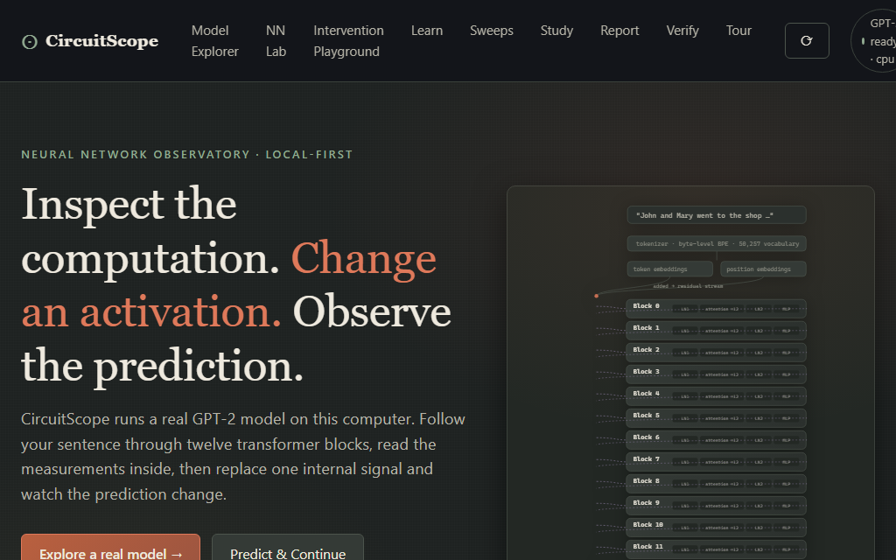
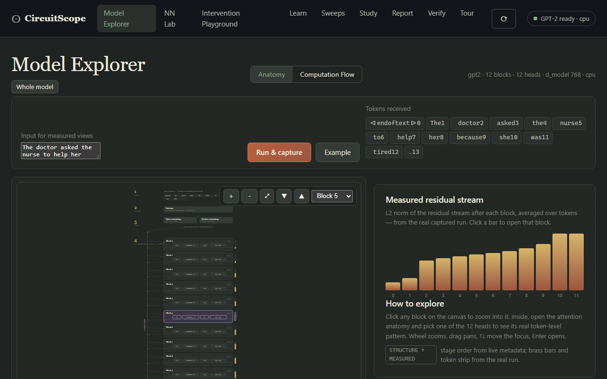
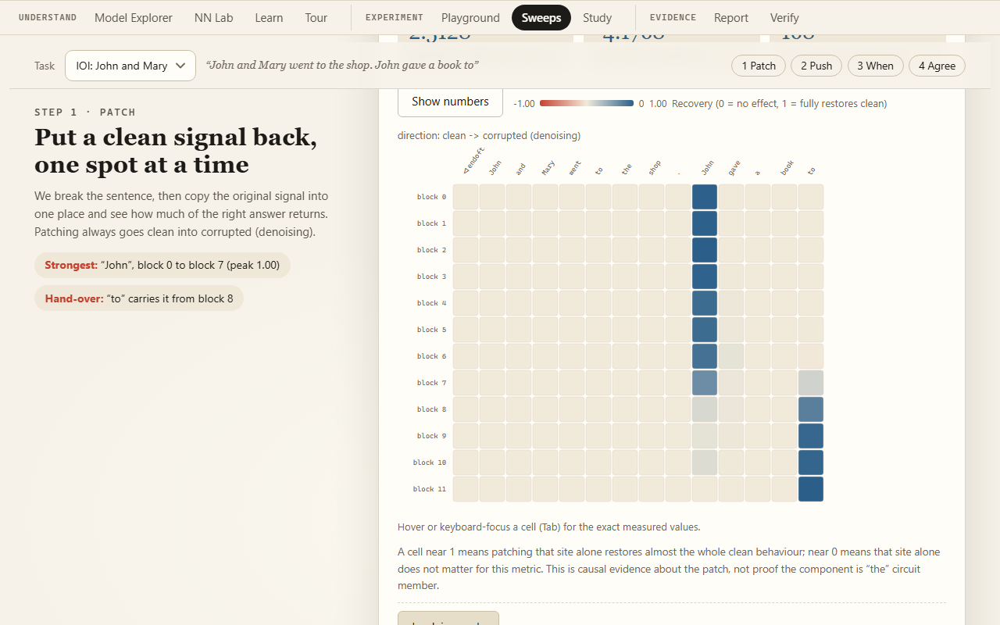
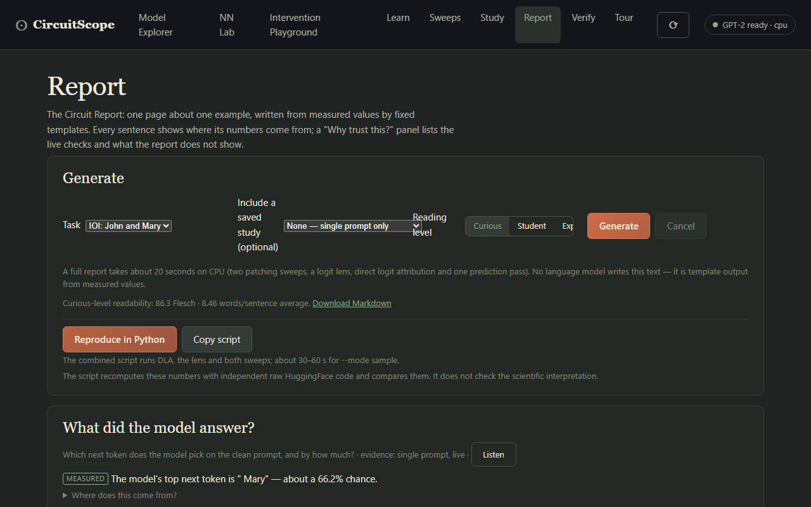
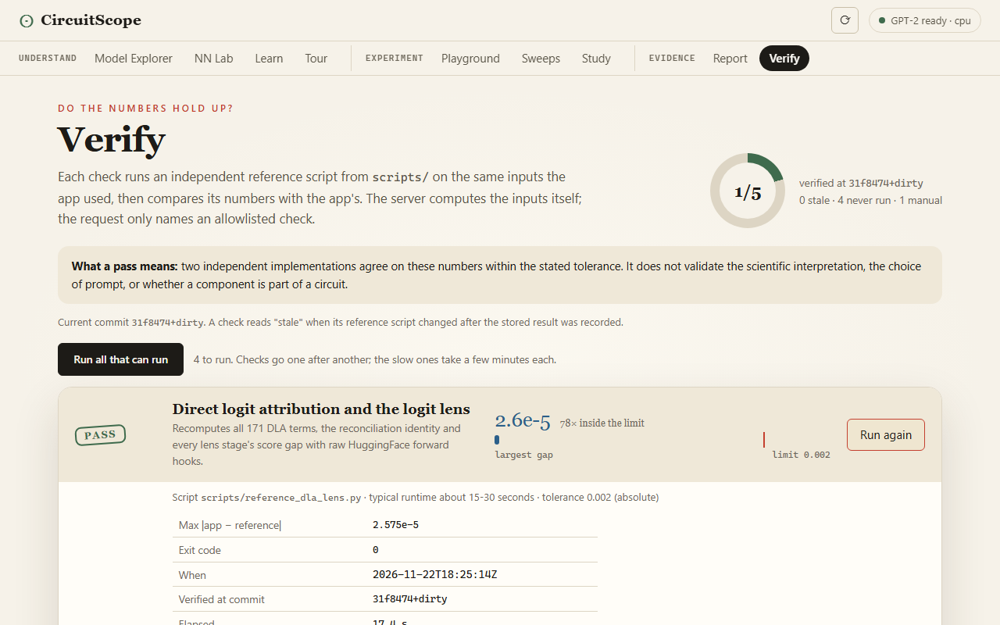
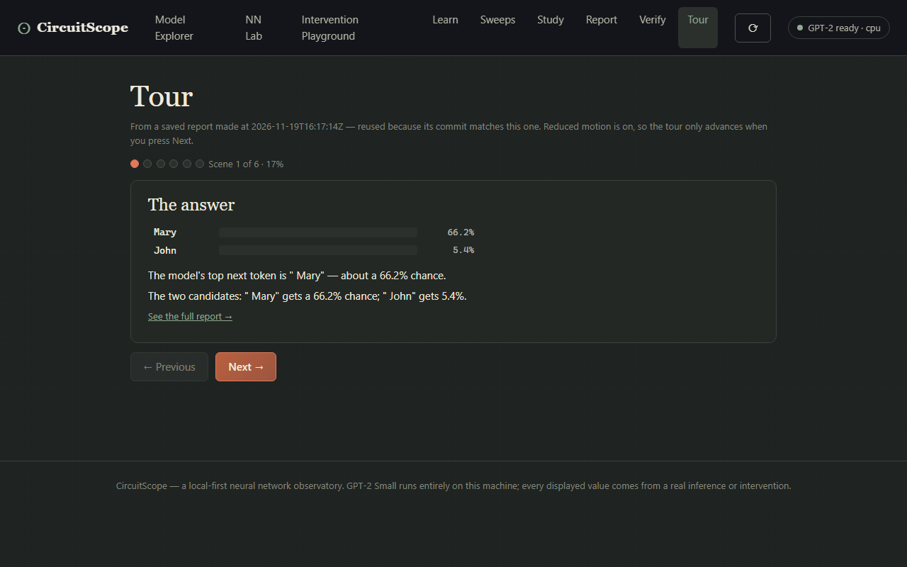

# CircuitScope

**Inspect the computation. Change an activation. Observe the prediction.**

CircuitScope is a local-first workbench for looking inside a real transformer
model. It runs GPT-2 Small on your machine, measures what each part
contributes, lets you intervene inside the model, and writes a plain-English
report in which every number can be traced to a stored, reproducible run.

In one sentence for a non-technical reader: it shows how a small language
model processes your sentence, what each part of the model does, and how the
prediction changes when you alter one internal signal. Everything runs on your
laptop and the graphs come from the model's actual computations.

For a technical reader: a Python/PyTorch engine loads GPT-2 Small through a
version-checked TransformerLens bridge and runs activation-patching sweeps,
direct logit attribution, the logit lens and attribution patching over
template-generated prompt sets, then compares the methods. A FastAPI backend
stores every experiment with provenance (git commit, model revision, library
versions) and can export a standalone Python script that reproduces a
displayed number. A React/TypeScript frontend renders the measurements, a
template-generated Circuit Report, and a Verify page that re-runs independent
reference implementations and shows whether they agree with the app.

CircuitScope is not a chatbot and not a wrapper around a hosted model API. It
also does not claim new research results: every method is an established one
(see the references below), and the point is a workflow that is integrated,
cross-checked and explainable.

## Screenshots

| | | |
| --- | --- | --- |
|  |  |  |
| Landing: live model status and a measured prediction | Explorer: the 12-block model anatomy | Sweeps: layer x position patching heatmap |
|  |  |  |
| Report: claims generated from measured values | Verify: reference scripts re-run live | Tour: six scenes over one report |

To regenerate them, run `.\start.bat` and then `node scripts\capture_readme_screens.js`.

## What you can do

**Find.** Activation-patching sweeps (layer x position, layer x head) as
heatmaps, direct logit attribution, the logit lens, attribution patching, and
prompt-set studies with controls. See
[sweeps, DLA and the logit lens](docs/concepts/sweeps-dla-lens.md) and
[prompt sets and attribution patching](docs/concepts/prompt-sets-attribution-patching.md).

**Explain.** The Circuit Report is built from fixed templates over the
measured values, so it cannot state anything that was not measured. Each
sentence shows where its numbers come from, and the page has a glossary, a
"Why trust this?" panel and a guided tour. See
[the report and its claims](docs/concepts/report-and-claims.md).

**Trust.** The Verify page re-runs independent reference scripts (plain
HuggingFace transformers and PyTorch) and shows the maximum deviation against
a declared tolerance. Every result offers a "Reproduce in Python" download.
See [verify and reproduce](docs/concepts/verify-and-reproduce.md).

## Quick start (Windows)

Prerequisites: Windows, Python 3.11, Node.js 20+. No admin rights needed.

```powershell
git clone <this repository>
cd CircuitScope
.\setup.bat        # checks prerequisites, creates .venv, installs dependencies, downloads GPT-2 (~550 MB on first run)
.\start.bat        # starts backend and frontend, waits until ready (about a minute), opens the browser
.\stop.bat         # stops what start.bat started and checks the ports are free
```

In PowerShell the `.\` prefix is required; in `cmd` you can type the names
directly.

- The app opens at `http://localhost:5173`, or the next free port up to 5180.
  API docs are at `http://127.0.0.1:8000/docs`.
- `setup.bat -WithE2E` also installs the Playwright browser, which is only
  needed for the end-to-end tests. Both scripts accept `-DryRun`.
- `scripts\download_model.py --check` reports whether the GPT-2 weights are
  already cached.

## Checking it yourself

1. **Verify page** in the app, as described above.
2. **Reproduce in Python:** download the script from any result and run
   `.venv\Scripts\python -I <script> --mode sample`.
3. **Tests:**
   `.venv\Scripts\python -m pytest backend\tests -q` (tests that need the real
   model are marked `model`; `-m "not model"` runs the fast subset),
   `cd frontend && npx vitest run`, `npx playwright test`, `npm run build`
   and `npx oxlint`.
4. **Scripts:** `python scripts\check_links.py` checks that documentation
   links resolve.

## Repository layout

| Path | Contents |
| --- | --- |
| `backend/` | FastAPI app: model runtime, sweep/DLA/lens/attribution analysis, job engine, provenance, SQLite storage, reproduce-script generator |
| `backend/tests/` | pytest suite |
| `frontend/` | React + TypeScript + Vite app and its tests |
| `scripts/` | Setup/start/stop tooling, independent reference scripts (`reference_*.py`), screenshot capture |
| `docs/` | [Architecture](docs/ARCHITECTURE.md) and plain-language concept notes |
| `examples/` | Example prompts, the task definition and reference head groups |
| `outputs/` | Created at runtime (database, logs, exports); git-ignored |

## Limitations

- CPU only. A layer x position sweep takes seconds, a report about a minute,
  and a 40-prompt study about half an hour.
- One model and one task family: GPT-2 Small and the IOI "John and Mary" task.
  The task registry makes adding tasks cheap, but only IOI has been studied.
- Direct logit attribution shows direct effects only, so it can disagree with
  exact patching. The app labels it as a partial view.
- Attention heatmaps are correlational. Only patching and ablation are causal,
  and only for the interventions actually measured.
- Results do not carry over to larger models or other tasks.

## References

- Wang, K. R., Variengien, A., Conmy, A., Shlegeris, B. and Steinhardt, J.
  (2023), *Interpretability in the Wild: a Circuit for Indirect Object
  Identification in GPT-2 Small*, ICLR 2023.
- Zhang, F. and Nanda, N. (2024), *Towards Best Practices of Activation
  Patching in Language Models: Metrics and Methods*, ICLR 2024.
- Syed, A., Rager, C. and Conmy, A. (2023), *Attribution Patching
  Outperforms Automated Circuit Discovery*, arXiv.
- Kramár, J., Lieberum, T., Shah, R. and Nanda, N. (2024), *AtP\*: An
  efficient and scalable method for localizing LLM behaviour to components*,
  arXiv.

## Licence

MIT. See [LICENSE](LICENSE).

Built with TransformerLens, Hugging Face transformers, FastAPI, React and Vite.
